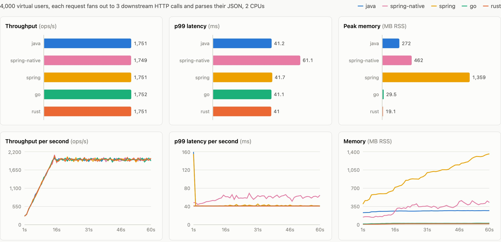

# prime-bench

[](https://github.com/jaderss/prime-bench/actions/workflows/ci.yml) [](https://sonarcloud.io/summary/new_code?id=jaderss_prime-bench) [](https://sonarcloud.io/summary/new_code?id=jaderss_prime-bench)

Java, Go and Rust generating big probable primes with the same Miller-Rabin test. Two runs per language: a batch job on all CPUs, and an HTTP server under thousands of virtual users. Every run writes a CSV with throughput, latency percentiles, memory and CPU, and a React dashboard reads them.

The point is to compare the concurrency models on the same work: Java virtual threads, Go goroutines, and Rust tokio with a rayon pool.

## Running

You need git, `make` and Docker running (Docker Desktop on macOS and Windows). The defaults use 6 CPUs in Docker: 4 for the app under test and 2 for the load generator. With fewer, lower `APP_CPUS` and `LOADGEN_CPUS` (see below). No JDK, Go, Rust or Node is needed on the host.

```bash
git clone https://github.com/jaderss/prime-bench.git
cd prime-bench
make bench        # build, then batch and server runs for java, go and rust
make dashboard    # open http://localhost:8080
make down         # stop everything
```

`make bench` takes about five minutes with the defaults. The first build pulls the base images and takes a few minutes more. CSVs land in `results/`, one per language and mode, named after the run (`20261021T172045Z_server_go.csv`). `make help` lists every target.

For a quick first look, about two minutes:

```bash
make bench BATCH_COUNT=40 USERS=200 DURATION=15s
```

Any value from `.env` can be overridden on the command line:

```bash
make batch LANGS=rust                    # one mode, one language
make server USERS=5000 THINK_TIME=1s     # heavier load
make bench JAVA_VERSION=25 LANGS=java    # same benchmark on another JDK
make bench APP_CPUS=2 LOADGEN_CPUS=1     # smaller Docker setup
make dashboard DASHBOARD_PORT=9090       # 8080 already taken
```

### Calling a server by hand

```bash
docker compose up -d --build go
curl "localhost:8082/prime?bits=512"
curl localhost:8082/stats
docker compose down
```

| Service | Port |
|---|---|
| java | 8081 |
| go | 8082 |
| rust | 8083 |
| dashboard | 8080 |

### Without make

The make targets are thin wrappers around compose. Set `RUN_ID` yourself, otherwise every run writes to `local_*.csv`. On Linux, also export your user id so the containers can write to `results/`.

```bash
export HOST_UID=$(id -u) HOST_GID=$(id -g)   # Linux only
docker compose build java go rust
docker compose --profile tools build loadgen
docker compose run --rm -e MODE=batch -e BITS=2048 -e RUN_ID=run1 go
docker compose up -d go
docker compose run --rm -e TARGET=http://go:8080 -e RUN_ID=run1 loadgen
docker compose down
```

### Without Docker

Each app also runs on its own toolchain (JDK 25+, Go 1.25+, Rust 1.85+, Node 22.12+). Memory and CPU are read from Linux `/proc`, so those two columns are 0 on macOS and Windows.

```bash
cd apps/go   && MODE=batch RESULTS_DIR=../../results go run .
cd apps/rust && MODE=batch RESULTS_DIR=../../results cargo run --release
cd apps/java && ./mvnw package && MODE=batch RESULTS_DIR=../../results java -jar target/prime-bench.jar
cd loadgen   && TARGET=http://localhost:8080 USERS=200 RESULTS_DIR=../results go run .
```

Without `MODE=batch` an app starts its server on port 8080 (`PORT` to change).

### Troubleshooting

| Error | Fix |
|---|---|
| `range of CPUs is from 0.01 to N` | Docker has fewer CPUs than `APP_CPUS` or `LOADGEN_CPUS`. Lower them, or raise the CPUs in Docker Desktop settings. |
| `Cannot connect to the Docker daemon` | Start Docker Desktop. |
| `port is already allocated` | Another process uses 8080 to 8083. Stop it, or use `DASHBOARD_PORT` for the dashboard. |
| Dashboard says "No results yet" | Run `make bench` first, then reload. |

## Upgrading a language

Versions live in `.env` and go into each Dockerfile as a build argument. Images are tagged with the version, so old and new builds sit side by side.

```
JAVA_VERSION=27
GO_VERSION=1.27
RUST_VERSION=1.99
NODE_VERSION=26
NGINX_VERSION=1.31
```

Change a line, run `make bench`, and the dashboard's "All runs" table shows both versions next to each other. CI builds and tests every app on the current and the previous release.

## Results

One run on an Apple M4 Max, Docker Desktop, 4 CPUs and 2 GB per app. Java 27, Go 1.27.3, Rust 1.99.1.



**Batch**, 200 primes of 2048 bits, 4 threads:

| | Primes/s | p50 ms | p99 ms | Peak RSS MB |
|---|---|---|---|---|
| Java | 16.4 | 179 | 951 | 163 |
| Go | 15.4 | 186 | 892 | 15.7 |
| Rust | 12.4 | 238 | 1230 | 2.6 |

**Server**, 2000 virtual users, 512-bit primes, 2 s think time, 60 s:

| | Requests/s | p50 ms | p99 ms | Peak RSS MB | CPU % |
|---|---|---|---|---|---|
| Java | 890 | 2.8 | 10.3 | 242 | 241 |
| Go | 861 | 33.7 | 448 | 22.3 | 346 |
| Rust | 890 | 4.1 | 15.7 | 4.5 | 292 |

What the numbers show:

- At 2048 bits Java and Go are close and Rust is 20 to 25% slower. `num-bigint` is portable Rust, while `BigInteger` has JIT intrinsics and `math/big` has assembly.
- At 512 bits the order changes. A batch run of 4000 primes gives Java about 1420/s, Rust 1265/s and Go 990/s, so Go spends more CPU per prime on small numbers.
- Under load that extra CPU turns into latency. Go serves the same traffic at 87% CPU, Java at 60%, and queueing near saturation grows much faster than load. Same throughput, 40x the p99.
- Go's garbage collector is not the main cost. The heap stays around 5 MB, so it runs about 200 cycles per second, but those take 3% of the CPU. `GOGC=400` cuts the p99 to about 120 ms with the same CPU use. Try it with `make server LANGS=go GOGC=400`.
- Memory is where the runtimes differ most: about 240 MB for the JVM, 22 MB for Go, 4.5 MB for Rust, for the same work.

Run it on your own machine before you quote any of this. See [METHODOLOGY.md](METHODOLOGY.md) for the limits.

## Layout

```
apps/java     Java 27, no framework. HttpServer on virtual threads, Maven, JUnit
apps/go       Go 1.27, standard library only
apps/rust     Rust 1.99, axum, tokio, rayon, num-bigint
loadgen       Go load generator, shares the CSV writer with apps/go
dashboard     React 19, Vite, Recharts, served by nginx
results       CSV output, mounted into every container
```

Each app reads its settings from the environment: `MODE` (`batch` or `server`), `BITS`, `COUNT`, `CONCURRENCY`, `ROUNDS`, `RUN_ID`. The CSV schema and the HTTP contract are in [METHODOLOGY.md](METHODOLOGY.md), together with what the numbers do not tell you.

## Testing

Each Dockerfile runs the language's tests before it builds the image, so `make build` fails on a broken test. The same prime and composite vectors (Mersenne primes, Carmichael numbers, a strong pseudoprime to bases 2, 3, 5 and 7) are checked in all three languages.

With the toolchains installed:

```bash
cd apps/java && ./mvnw verify           # also checks formatting
cd apps/go   && go test ./...
cd apps/rust && cargo test
cd dashboard && npm ci && npm run dev   # dashboard with hot reload on :5173, reads ../results
```
